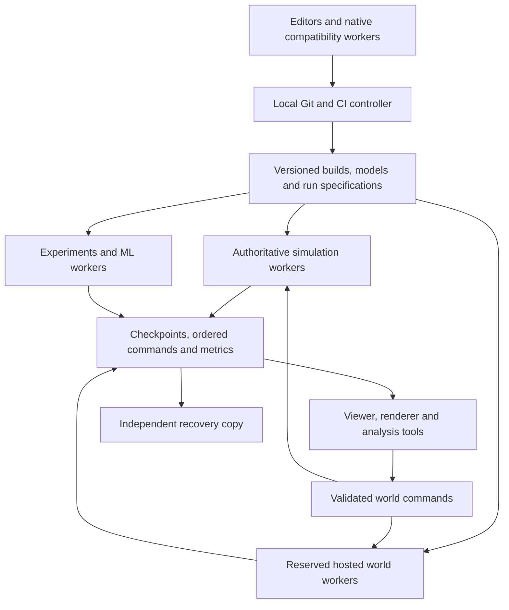

# Light Engine infrastructure architecture

Status: local discussion proposal, not an adopted governance decision or deployment.
Planning date: October 19, 2026.

## Design intent

Grow from a private, physically local research lab into an open, cross-platform simulation platform with industrial and entertainment hosting. Preserve a fast development loop throughout. Favor high useful compute density at each intermediate capacity zone, while retaining machines that provide unique platform coverage, interactive capacity, or recovery capacity.

The user has chosen tiers before budget, a home lab with dedicated power and cooling, several intermediate upgrade zones, and a likely next step involving DGX Spark and a Mac Studio-class machine. Compatibility nodes for CI/CD are an explicit part of the architecture, alongside the main workstation and ML nodes.

There is no finite configuration that eliminates bottlenecks for arbitrary workloads. The objective is to identify the next constraint early, reserve development capacity, and expand before research jobs consume the interactive loop.

## Starting point and decisions still open

The existing Blade has a Ryzen AI 9 365 with 10 cores / 20 logical processors, approximately 32 GB host memory, and an RTX 5070 Laptop GPU reporting 8,151 MiB of GPU memory. It remains useful as a Windows/x86 development machine, client, and compatibility target after larger nodes arrive.

The repository currently contains a Rust workspace scaffold and benchmark harness with no implemented simulation kernel, GPU backend, ML integration, persistence, or distributed runtime. README.md and NOTEPAD.md describe a simulation/math kernel, rather than an operating-system kernel. CI checks formatting, linting, builds, and tests on Linux, Windows, and macOS; it does not establish a completed numerical validation suite or a fixed architecture matrix.

Before credible scene-capacity estimates, define the algebra/basis, metric, coefficient count, precision, interaction model, and first Hamiltonian. README and NOTEPAD now agree on initial grades 0–2; the exact algebra remains a numerical design decision. Infrastructure should support its investigation.

## Four persistent parts of the lab

| Part | Responsibility | Growth policy |
| --- | --- | --- |
| Development and compatibility fleet | Editors, native builds, CPU reference checks, platform/backend validation, packaging | Retain representative architectures; add modest dedicated runners before CI interferes with research |
| Research compute pool | Simulation ensembles, dataset generation, learning, inference experiments, offline rendering | Add memory, GPUs, and interconnected nodes according to measured job requirements |
| Durable control and data services | Private source, CI coordinator, build/artifact registry, experiment catalog, world/checkpoint storage, backups | Keep recoverable independently of a busy or failed accelerator node |
| Live world/service pool | Authoritative worlds, interactive sessions, inference serving, visualization and streaming | Add when the runtime exists; reserve capacity and define latency/recovery objectives |

A machine can initially fill several roles. Give each role explicit reservations and an exit path to its own machine. A compatibility fleet and a throughput cluster are different dimensions of growth.

## Intermediate capacity zones

These are useful operating envelopes, not a requirement to buy every machine in sequence. Add nodes for concurrency; replace or augment a node when an individual job no longer fits. Reuse earlier machines as compatibility workers, viewers, inference nodes, or recovery tools.

| Zone | Physical shape | What it unlocks | Move onward when |
| --- | --- | --- | --- |
| 0 — Kernel bench | Existing Blade; native Windows plus an optional WSL2 Linux development environment | Reference implementation, SIMD experiments, compact CUDA checks, headless tooling | CPU/RAM/VRAM pressure or thermal limits slow the feedback loop |
| 1 — Local platform triangle | Blade + DGX Spark + Apple Silicon Mac Studio-class machine | Native Windows/x86, Linux/Arm/CUDA, macOS/Arm/Metal coverage; concurrent personal ML and development | CI and research compete, or one job exceeds practical memory/bandwidth |
| 2 — Independent lab services and CI | Small always-on native Linux/x86 host; durable storage and backup; dedicated Windows runner when needed | Native Linux/x86 checks, local automation, reliable source/artifacts, CI without occupying the laptop | The compute pool, rather than coordination/builds, limits progress |
| 3 — Fast discrete GPU workstation | Optional 32 GB RTX 5090 class, or directly one 96 GB RTX PRO; substantial host RAM and NVMe | Higher-bandwidth accelerator experiments, graphics, larger scenes and model work | Single-job VRAM or concurrent workloads exceed one GPU |
| 4 — Dual GPU research node | Two suitable GPUs; for example 2 × 96 GB RTX PRO | Separate interactive and training devices, parallel experiments, explicit multi-GPU prototypes | Resource reservations repeatedly leave jobs queued or one job needs a faster shared fabric |
| 5 — Large coherent-memory branch | DGX Station, with a graphics GPU where required | Large local models and CPU/GPU memory experiments; Arm deployment validation | HBM capacity, throughput, concurrency, or inter-GPU communication demands increase |
| 6 — Dense four-GPU node | Validated 4 × 96 GB RTX PRO Max-Q workstation/server | 384 GB aggregate GPU memory; several large independent jobs or explicitly sharded jobs | Queue pressure, fabric requirements, or individual jobs justify a server tier |
| 7 — Dense eight-GPU PCIe server | Validated 8 × RTX PRO 6000 Server system | 768 GB aggregate GPU memory; a compact lab batch/render/inference server | PCIe communication or high-bandwidth-memory requirements dominate |
| 8 — NVSwitch compute node | DGX B300: eight B300 GPUs and approximately 2.3 TB GPU memory | Large multi-GPU training and simulation work with high-bandwidth GPU interconnect | One node is demonstrably saturated by useful work or availability requires another |
| 9 — Small private compute cluster | Two to four suitable accelerator nodes plus independent control/storage and compatibility fleet | Parallel large experiments, dedicated service capacity, multi-node validation | Measured workload, network, facility, and operating needs justify another fabric/generation |
| 10 — Rubin server/rack branch | Evaluate liquid-cooled Vera Rubin NVL4; NVL72 only with a matching facility and workload | A next-generation dense server or rack-scale fabric | Procurement and benchmarks demonstrate a meaningful improvement over expanding the existing pool |
| 11 — Public deployment fleet | Research pool plus separate industrial/live world/entertainment service capacity | Public releases, managed private installations, regional hosting, tenant isolation and service operations | Grow from observed admission, latency, reliability, and economics |

The next recommended zone is the platform triangle, with a modest native Linux/x86 services/CI node soon after. Spark and Mac Studio add different execution targets. Neither needs to replace the Blade.

### Concrete next-zone configuration

Retain the Blade as the main Windows development/client target. Add one 128 GB DGX Spark for native Linux/Arm/CUDA experiments and one Mac Studio for native macOS/Arm development, compilation, and Apple GPU work. For the Mac, start planning around M5 Max with 64–128 GB unified memory; consider M5 Ultra with 256–512 GB when substantial Apple-side model capacity is itself a goal. These are proposed configurations, not a measured requirement. Apple currently lists those configurations and 10GbE on Studio. [Apple Studio specifications](https://www.apple.com/mac-studio/specs/)

Add a compact native Linux/x86 services/build host with approximately 64–128 GB RAM as a planning allowance, fast local SSDs, and network support matching the lab switch. Choose exact capacity after build/cache/artifact measurements. It should not need an expensive GPU to host source, CI coordination and CPU compatibility jobs. Add a discrete NVIDIA GPU there later if native Linux/x86 CUDA acceptance requires it, or use the future GPU workstation for that lane.

As concurrency grows, add a small dedicated Windows runner and a Mac mini-class native macOS runner. This preserves platform checks even when the Blade is mobile and the Studio is occupied. Keep accelerator conformance tests on actual accelerator nodes; a small CPU runner cannot substitute for a CUDA/Metal test device.

Use the lab's wired LAN with a proposed 10GbE backbone, durable artifact/checkpoint storage, and a separate recovery copy. Reserve CI/development capacity on Spark and Studio until dedicated runners exist. Do not add a heavy research queue, clustered storage, or public service orchestrator merely to connect these initial machines.

## Verified hardware distinctions

Specifications below were checked against current primary sources. They are planning inputs; actual configuration, availability, lead time, support, and facility requirements need an OEM quote when procurement becomes concrete.

- DGX Spark has 128 GB coherent LPDDR5X memory, a 20-core Arm CPU, and 273 GB/s memory bandwidth. Its 140 W chip TDP and 240 W supply are different measurements. It is a dense local capacity/portability node, with a different bandwidth profile from discrete GDDR or HBM GPUs. [NVIDIA Spark](https://www.nvidia.com/en-us/products/workstations/dgx-spark/)
- RTX 5090 has 32 GB GDDR7, 575 W GPU power, and no NVLink. [NVIDIA specifications](https://www.nvidia.com/en-us/geforce/graphics-cards/50-series/rtx-5090/)
- RTX PRO 6000 Blackwell variants have 96 GB ECC GDDR7 each. Max-Q is 300 W and designed for configurations of up to four GPUs. Four cards therefore total 1.2 kW GPU-only; the complete system draws more. [NVIDIA RTX PRO family](https://www.nvidia.com/en-us/products/workstations/professional-desktop-gpus/rtx-pro-6000-family/)
- A verified eight-GPU 4U example is Supermicro SYS-422GA-NRT. Eight 600 W RTX PRO Server GPUs imply 4.8 kW GPU-only. Airflow, electrical input, CPU/RAM configuration, acoustics, and total draw require system-level planning. [Supermicro system](https://www.supermicro.com/en/products/system/gpu/4u/sys-422ga-nrt)
- DGX Station currently specifies 748 GB coherent memory: 252 GB HBM3e plus 496 GB LPDDR5X, with a Grace Arm CPU. These are distinct bandwidth tiers. It specifies 1,600 W system power and a 20 A circuit requirement. [Current NVIDIA Station specifications](https://www.nvidia.com/en-us/products/workstations/dgx-station/)
- DGX B300 is an eight-GPU x86 server, with 288 GB per GPU, a 10RU chassis, and 14.5 kW specified consumption. It is distinct from the 72-GPU Grace/Blackwell DGX GB300 rack and the GB300 Desktop Superchip in Station. [NVIDIA B300 installation specifications](https://docs.nvidia.com/dgx/dgxb300-user-guide/introduction-to-dgxb300.html)
- Vera Rubin NVL4 is an official four-GPU/two-Vera-CPU liquid-cooled MGX server path. NVIDIA announced OEM availability expected in Q4 2026. This does not establish an available personal Rubin workstation. NVL72 comprises 72 Rubin GPUs, 36 Vera CPUs, and approximately 20.7 TB HBM4. [NVIDIA platform](https://www.nvidia.com/en-us/data-center/vera-rubin-nvl72/), [NVL4 announcement](https://nvidianews.nvidia.com/news/nvidia-vera-rubin-delivers-world-class-supercomputers-for-science)

Separate GPU memories do not automatically become one large allocation. A 4 × 96 GB system offers 384 GB aggregate; a job needs partitioning/sharding to use it as a larger working set. Ordinary data parallel learning replicates the model. RTX PRO Server Edition has no NVLink. [PyTorch distributed tutorial](https://docs.pytorch.org/tutorials/intermediate/ddp_tutorial.html), [Lenovo RTX PRO specifications](https://lenovopress.lenovo.com/lp2263-thinksystem-nvidia-rtx-pro-6000-blackwell-server-edition-pcie-gen5-gpu)

Low-precision tensor FLOPS do not establish throughput or accuracy for Light's scientific kernel. Compare validated particle-steps/s at the selected precision, time-to-quality for learning, bandwidth, memory capacity, watts, and physical footprint.

## Cross-platform contract and compatibility fleet

The first support promise should be the portable CPU kernel, world formats, CLI, and validation corpus. GPU support is a capability matrix, rather than a promise that every accelerator backend implements every feature or precision identically.

| Target | Initial physical coverage | Required checks | Accelerator checks |
| --- | --- | --- | --- |
| Windows/x86-64 | Blade; later a dedicated Windows runner | Rust build/test, CPU oracle, SIMD dispatch, CLI, file/replay compatibility, packaging | NVIDIA CUDA where the Windows backend is supported; later graphics backend checks |
| Linux/x86-64 | WSL2 for early development; add a native Linux/x86 node | Same CPU/format checks; native Linux behavior; AMD64 container and package execution | CUDA on actual supported GPU hardware; later server/network checks |
| Linux/Arm64 | DGX Spark | Same CPU/format checks, Arm SIMD paths, ARM64 container execution, dependency availability | CUDA on Spark; run datacenter GPU checks separately as those systems arrive |
| macOS/Arm64 | Mac Studio-class Apple Silicon node | Same CPU/format checks, Arm SIMD paths, native CLI/tooling and macOS packaging | Metal/MPS or a chosen portable GPU backend where implemented |

Windows/Arm64, Intel macOS, AMD/Intel discrete GPUs, RISC-V, and 32-bit are separate decisions. They are not covered by owning these three main machines. NOTEPAD currently defers RISC-V and 32-bit.

Use a scalar reference and runtime-selected CPU SIMD implementations. Compile and execute both x86-64 and Arm64 builds; cross-compilation and emulation are useful early checks but do not validate actual hardware behavior or performance. A Linux container running on a Mac does not validate native macOS.

Keep compute backends behind a defined capability interface: precision, supported operations, determinism mode, memory model, and device limits. CUDA is a reasonable optimized NVIDIA path; Metal/MPS and portable GPU APIs need independent validation. PyTorch MPS does not support float64, so an FP64 scientific path on the Mac must remain CPU-based unless a different validated approach is introduced. [PyTorch MPS documentation](https://docs.pytorch.org/docs/main/notes/mps.html)

WSL2 is useful for development but has documented GPU/memory limitations. Use native Linux hardware for authoritative Linux performance and final server acceptance. [NVIDIA WSL guide](https://docs.nvidia.com/cuda/wsl-user-guide/index.html)

## Local CI/CD and release flow

Start with repository-owned check/build commands that run locally on each native target. When the fleet arrives, use a LAN-only CI coordinator with native workers. Gitea Actions is a candidate that preserves a familiar Actions workflow shape; validate each workflow against its supported features. Host runners are useful for native Windows/macOS/GPU checks; Linux job containers provide pinned environments where appropriate. Use explicit OS/architecture/backend labels. [Gitea runner labels](https://docs.gitea.com/runner/labels/), [native runner operation](https://docs.gitea.com/1.25/usage/actions/act-runner/)

CI should have distinct lanes:

1. Fast change checks: formatting, build, targeted unit/reference tests and small state-format round trips.
2. Native compatibility: OS/architecture CPU corpus, snapshot/replay interchange, CLI behavior and package smoke tests.
3. Backend validation: shared numerical cases with precision/error bounds; explicit unsupported-capability results; no silent precision changes.
4. Scheduled performance: dedicated quiet hardware, long-run invariant drift, memory/bandwidth/thread scaling, GPU regression and representative ML workload checks.
5. Release candidates: pinned builds, Linux AMD64/ARM64 execution, Windows/macOS packages, signatures where applicable, release notes and a restore/upgrade drill.
6. Deployment promotion: a tested artifact digest moves from local experiment to staging to hosted/service installation; a public announcement changes publication policy rather than triggering an infrastructure rewrite.

Keep one compatibility worker or reserved slot available during heavy research jobs. As the lab grows, use smaller dedicated platform runners so the primary Mac, Spark, and workstation are not the only release path. A single Mac does not prove compatibility with every supported macOS version; define minimum/current OS coverage explicitly.

Before announcement, source, CI logs, snapshots, model/dataset artifacts, registry, and metrics should default to local services. Dependency downloads can remain outbound-only; locally cached packages/images reduce repeated network dependence. A GitHub self-hosted runner still receives work from GitHub and is not a fully local CI control plane. [GitHub runner architecture](https://docs.github.com/en/actions/concepts/runners/self-hosted-runners)

After announcement, public pull requests should run on disposable isolated workers without access to private lab data or deployment credentials. Trusted lab GPU benchmarks can run after review on an isolated path. GitHub documents the persistent-compromise risk of public untrusted jobs on self-hosted runners. [GitHub secure-use guidance](https://docs.github.com/en/enterprise-cloud@latest/actions/reference/security/secure-use)

## Software layers and ownership

Suggested future modules, introduced as needed rather than all scaffolded now:

- Mathematical kernel: stable logical particle identities, algebra, interactions, integrators, invariant measurement; independent of hosting, rendering, Python, and optional ECS semantics.
- Execution backends: scalar oracle, CPU SIMD/parallel, single-GPU, then multi-GPU. Preserve one mathematical contract and explicit backend capability reporting.
- World runtime: ordered commands, time advancement, ownership, checkpoints, replay, branching and transactions.
- Tools: CLI/TUI, voxel inspector, editor, sensor projections, profiling and comparison.
- ML adapter: a Python-facing boundary for datasets, rollouts, training and inference. Begin with process/file/API boundaries; optimize data transfer only after measuring it. An ML connection alone does not make the solver differentiable.
- Worker/service interfaces: the same headless executable accepts a versioned run specification locally, in a batch job, or as an authoritative hosted world.

Three execution lanes share the contracts:

| Lane | State authority | Scheduling |
| --- | --- | --- |
| Simulation/world | One writer per world or scientifically validated partition | Reserved capacity and bounded step deadlines where interactive |
| View/render/editor | Derived snapshots/deltas; editor emits commands | Frame/interaction latency; independent rendering capacity as needed |
| ML/experiments | Immutable inputs and versioned outputs; accepted model/policy changes become world commands | Throughput, quotas, checkpointing and preemption |

A live training job should not mutate an authoritative world's model or numerical rules implicitly. Activating a new model is an explicit versioned event.

## Durable world and experiment state

Define portable logical serialization independently of AoSoA lane width, storage order, device address, and SIMD architecture. Store execution layouts as derived caches when useful. Include:

- Schema version, units, coordinate/basis/metric definitions, stable particle/object IDs.
- Code/build digest, model/material/asset versions and source data lineage.
- Initial conditions, ordered tick-stamped commands and parameters.
- Integrator, timestep, precision, backend and reproducibility policy.
- Random stream state/counters, pending events, integrator history and all solver/controller/adaptation state that affects restart.
- Parent checkpoint/world branch, checksums, checkpoint tick, measured invariants and outputs.

A viewer snapshot may omit restart-critical state. Define display exports and restart checkpoints separately. Begin with full checkpoints plus an ordered command/event log. Add chunking/deltas and content addressing when data volumes justify them.

Exact replay is a narrow promise for a specified build/backend/configuration. Across CPU/GPU/architecture changes, compare documented numerical/invariant bounds and statistical behavior where applicable; do not promise universal bitwise agreement. FMA and reduction order can change floating-point results. [NVIDIA floating-point guidance](https://docs.nvidia.com/cuda/cuda-c-best-practices-guide/index.html)

## Data, network and scheduling stack

At the first multi-machine zone, use local NVMe for active builds and job scratch, a durable LAN artifact/checkpoint volume, and an independently recoverable encrypted backup. Keep at least one backup disconnected or physically separate; perform restore trials. RAID or snapshots on the same machine do not provide that independent recovery copy.

Start the experiment catalog as files plus a small local database; add a service database when concurrent users/jobs need it. Keep bulk arrays, datasets, models and world blobs outside the metadata database. Add an S3-compatible API only when distributed workers or deployment tooling benefit from it. Avoid making a distributed filesystem a prerequisite for a three-machine lab.

Use wired networking. A 10 GbE lab backbone is a reasonable initial design target if chosen devices/adapters support it; expand storage/data paths to 25/100 GbE when measured ingestion/checkpoint times justify that. Distributed tightly coupled GPU jobs require a separately designed RDMA fabric and collective/communication benchmarks. A fast management LAN does not replace NVLink or a datacenter scale-out network.

Keep management, trusted CI/control, storage/compute, and future public tenant traffic separated through appropriate switch/firewall policies. Out-of-band management must remain private. Node-local scratch should be disposable; source, catalog and accepted world checkpoints must be recoverable without a working training node.

One workstation needs process supervision and resource reservations. Several batch machines justify a queue: Slurm is a reasonable simulation/training option with explicit GPU resources. [Slurm GPU scheduling](https://slurm.schedmd.com/gres.html)

Add Kubernetes for an actual fleet of long-running public services; evaluate Agones when game/session allocation is needed. One scheduler must own a given physical GPU pool. Separate Slurm and service pools, or use a deliberate integration rather than allowing both to allocate the same hardware. [Kubernetes device plugins](https://kubernetes.io/docs/concepts/extend-kubernetes/compute-storage-net/device-plugins/), [Agones](https://agones.dev/site/docs/overview/)

## Expansion triggers and development headroom

Initial operating policies below are proposals to tune from real measurements, not measured Light Engine performance claims:

- Reserve an interactive CPU/RAM budget and at least one appropriate device or scheduled slot for development/compatibility; heavy batch work consumes the remaining capacity.
- For planned working sets, aim for approximately 20–30% unused memory after including peak scratch, neighbor/index buffers, graphics use, checkpoint staging and framework overhead. Treat overcommit as an explicit experiment.
- Record feedback time, queue wait and cancelled/preempted work. Trigger expansion when representative jobs repeatedly miss agreed turnaround targets, rather than only after out-of-memory failures.
- Track validated particle-steps/s, error/invariant bounds, bytes per particle, peak allocation, bandwidth, transfer/communication fraction, and checkpoint throughput.
- Track training samples/s, time-to-quality, model/optimizer/activation footprint, inference latency, concurrency and energy per completed job.
- Forecast the next workload envelope; buy the constrained resource. Spare tensor throughput cannot repair insufficient CPU memory, slow builds, storage stalls or a non-parallel solver.

Simulation memory should be estimated from N particles × live attributes × coefficients × bytes per coefficient × simultaneous buffers, plus topology/neighbors, indexing, scratch, solver state and checkpoint staging. The current unspecified algebra prevents a defensible maximum-particle claim.

Scale independent worlds, ensembles, parameter sweeps and dataset workers first. Distributing one world requires explicit partition ownership, halo exchange, global interactions/reductions, migration, synchronization, fault recovery, and validation of conservation/error. More nodes can slow a communication-bound world.

## Industrial and entertainment deployment

Industrial deployment needs pinned numerical/model versions, documented physical limits, reproducible inputs, regression acceptance, provenance, private installation support and tested checkpoint recovery. Public/interactive hosting additionally needs authentication, quotas, admission control, tenant accounting, abuse handling, region/latency placement and live capacity reservations.

Rendering and video streaming are separate capacity budgets from authoritative headless simulation. Customer-facing worlds should survive training-node maintenance through spare compatible capacity and accessible durable checkpoints. A second machine only provides recovery if that capacity, state and recovery path are tested. Define recovery-point and recovery-time objectives before offering availability promises.

Untrusted plugins or customer code need appropriate VM/process/network isolation beyond merely sharing a container host or using a GPU utilization feature. Keep research, public workloads and administrative credentials in separate trust domains.

A home lab can remain the private development and validation origin. Public geographic hosting and customer private installations can reuse the artifacts and contracts after announcement, while research datasets and unpublished worlds remain private by policy.

## Home-lab facility gates

For each density increase, budget complete-system sustained power, cooling rejection, airflow or liquid loop/CDU requirements, acoustic conditions, UPS ride-through/shutdown, service access, rack load and recovery. GPU TDP, PSU capacity and measured wall draw are different quantities.

Spark/Mac-class appliances, a dense workstation, a multi-kilowatt PCIe server, B300, and liquid-cooled Rubin are distinct facility envelopes. Dedicated home-lab power/cooling is a starting condition; each high-density server still requires a validated equipment-specific installation plan. Preserve separate power and recovery for the control/data services where practical.

## Local incubation and announcement gates

The current checkout has GitHub remotes and hosted Actions workflows. Their existence does not establish remote visibility or privacy. This proposal does not change them or publish anything.

Repository maintenance found that the tracked .env was empty. It is now removed from the index, and environment files are excluded from Git and the Docker build context. Historical configuration still needs a sensitivity review before a public release; ignore rules do not remove historical files.

Before public release, reconcile LICENSE.md's AGPL label and additional enterprise wording with the intended license/commercial model, and define when public governance starts. This is release preparation, not a license or governance change made by this proposal.

The announcement transition should publish selected source, formats, packages, benchmarks and contributor documentation. Keep private worlds/data separate from the public code repository. Operate public CI and hosted products through isolated promotion paths; retain the local development and compatibility fleet.

## First build-out sequence

1. Define the smallest validated numerical problem, reproducibility modes and shared acceptance corpus.
2. Establish repeatable local builds/checks and an artifact/run manifest on the Blade.
3. Add Spark and an Apple Silicon Mac; verify native Linux/Arm/CUDA and macOS/Arm CPU/tooling paths.
4. Add a modest native Linux/x86 services/CI node, durable storage and an independent backup; keep the Blade available for Windows checks until a dedicated runner is justified.
5. Introduce local CI orchestration, explicit runner capabilities, package/format interchange tests and reserved development capacity.
6. Measure representative simulation and ML bottlenecks; select the next discrete-GPU, coherent-memory or additional-node zone from those measurements.
7. Expand to dense servers, NVSwitch nodes, and a small cluster only as the workload and facility gates become concrete.

No implementation, dependency installation, remote write, publication, or hardware purchase is performed by this document.
